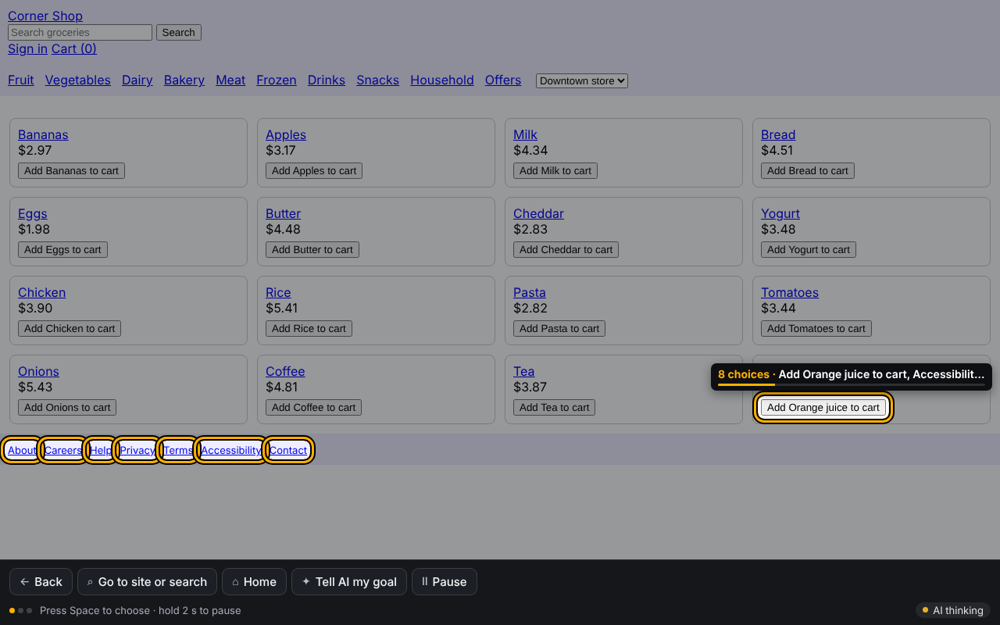
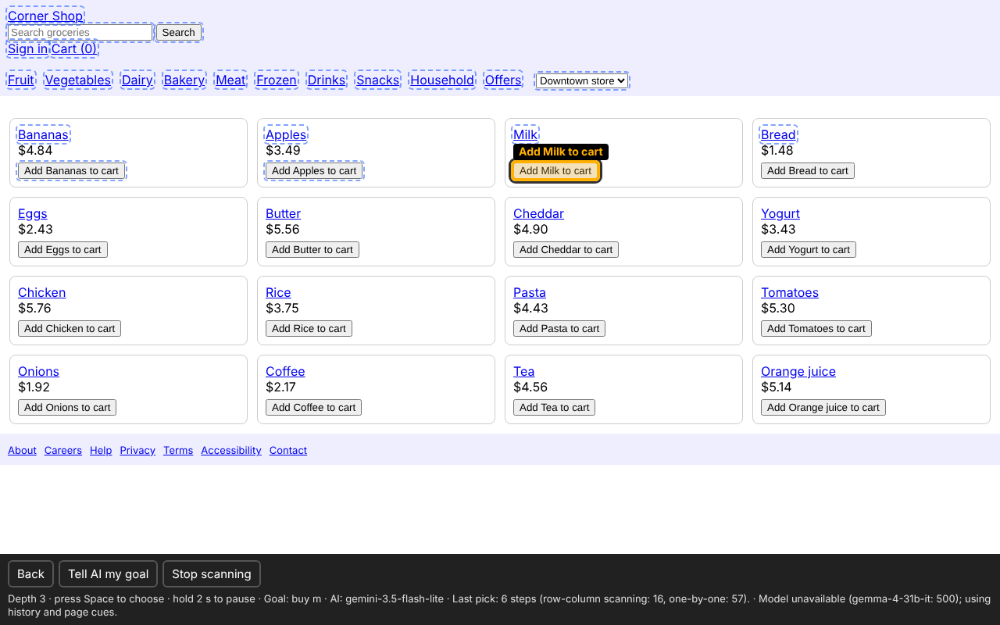
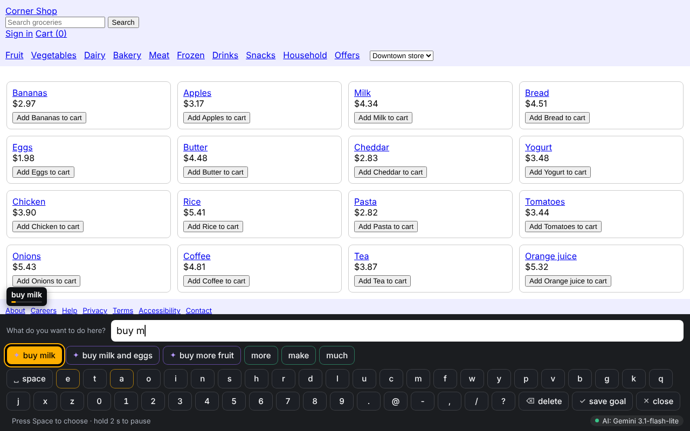
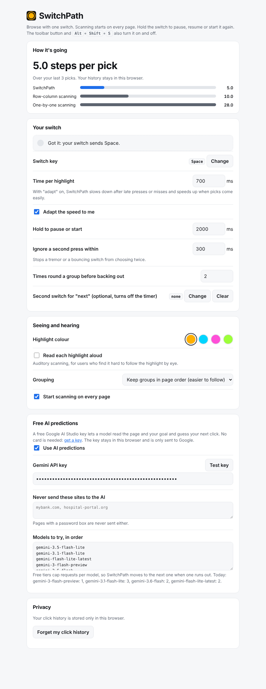
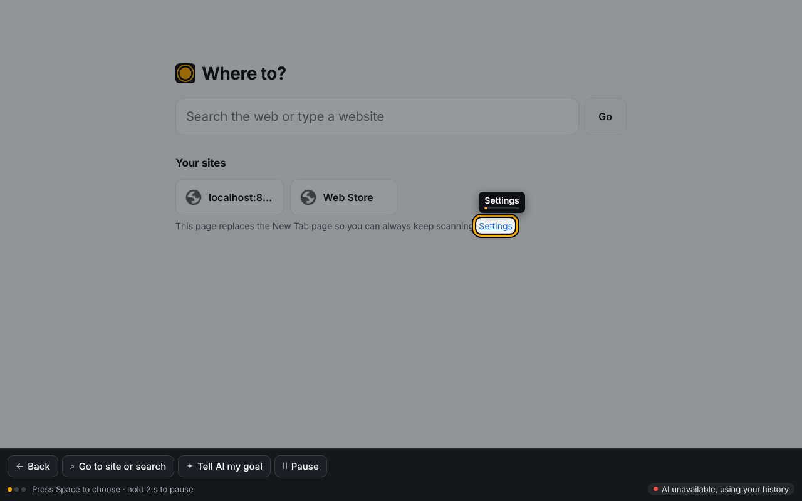

# SwitchPath

**Browse the web with one switch, in about half the presses.**

People with ALS, cerebral palsy, spinal cord injury or locked-in syndrome often control a computer with a single switch: a button pressed with the head, a puff tube, a blink sensor. A highlight moves over the choices and they press when it reaches the one they want. Every step the highlight takes costs them about a second.

The web is the hard case for this. A shopping page has 30 to 300 clickable things. Today's options:

- **iOS / macOS Switch Control** step one element at a time. Reaching the 40th link takes 40 steps.
- **Row-column scanning** (most AAC devices, Grid 3) picks a row, then an item in it. This is better, but still blind to what the user wants.
- **Windows has no built-in switch scanning at all**, and Chrome only has it on ChromeOS. Paid AAC suites cost hundreds of dollars.

SwitchPath is a free Chrome extension that treats every screen as a prediction problem:

1. **It predicts what you'll pick.** Each choice gets a probability from three sources: page cues (element type, size, position, a model fitted on 73 real websites), **your own click history** on that site, and a **free-tier AI model** (Gemini Flash-Lite, under 1 s per call). The model reads the page and, if you said what you want to do, your goal.
2. **It builds the fastest possible scan for those odds.** The choices are arranged into the scan tree with the fewest expected steps. This is a Huffman-style code with unequal costs, which a dynamic program solves exactly. Likely choices sit one or two steps away. Unlikely ones are still reachable, just deeper. Groups stay as contiguous regions of the page, so the highlight is easy to follow.
3. **It keeps learning.** Every pick updates your history. Your daily sites get faster the more you use them, and your history never leaves your browser.

The AI model and the algorithm do different jobs. The model brings understanding: it knows "Add to cart" matters when your goal is "buy milk". The algorithm turns any guess, good or bad, into the cheapest scan, so a wrong guess costs a step or two instead of a dead end. If the model is unavailable or out of free quota, history and page cues still work offline.

## Results

Benchmark: **Mind2Web** (Deng et al., NeurIPS 2023), train split. It covers 1,009 real tasks done by people on 73 live websites (airlines, shops, car rentals, ticketing): **7,350 clicks**, with every on-screen element and its position. For each click we count how many scan steps a single-switch user needs, including scrolling down to reach it. All methods see the same 1280×720 screens and the same Scroll / Back buttons.

| Scanning method | Steps per click | Target within 5 steps |
| --- | --- | --- |
| One-by-one (iOS / macOS Switch Control) | 43.3 | 5% |
| Row-column (AAC devices) | 14.2 | 20% |
| SwitchPath, uniform odds (algorithm only) | 7.7 | 27% |
| SwitchPath, page cues | 7.3 | 39% |
| **SwitchPath, page cues + history** (groups in page order, the default) | **7.1** | 34% |
| SwitchPath, page cues + history, fewest-steps grouping | 6.7 | 37% |

With the free AI model, on 299 randomly chosen clicks (Gemini Flash-Lite; blend weights fixed before the run):

| Setup | Steps per click | Target within 5 steps |
| --- | --- | --- |
| SwitchPath, page cues + history | 7.1 | 38% |
| + AI model reading the page only | 7.3 | 36% |
| + AI model told the user's goal | **6.5** | **48%** |
| Row-column | 14.6 | 21% |

On its own, the model reading the page doesn't beat page cues and history. Told the user's goal, it cuts steps by another 8% and gets the target within 5 steps nearly half the time. Across blend weights from 10% to 75% these numbers move by under 0.3 steps. Trusting the model at 90% makes things worse (7.0 steps with the goal), which is why the algorithm keeps the final say.

Notes:
- "Steps" are highlight positions the user waits through. At 1 second per step, steps ≈ seconds per click.
- Page-cue weights are always fitted on the *other* half of the websites, never the site being scored.
- History only uses tasks done *earlier* on the same site, as if one person had done them in order.

Reproduce it with `node bench/run.mjs --data mind2web_train_steps.jsonl.gz --llm 300`. You need a free `GEMINI_API_KEY` for `--llm`. To build the data file, take the Hugging Face parquet copy of the Mind2Web train split. For each action, write one JSON line with `task_id, website, domain, task, step, op, value, targets` and `elements: [{id, tag, text, attrs, bbox}]`, using the positive and negative candidates. Get each element's text from `cleaned_html` by `backend_node_id`.

## Screenshots

| Scanning a page: groups light up in turn | After the user typed a goal with the switch, the scan reaches "Add Milk to cart" |
| --- | --- |
|  |  |
| **Scanning keyboard with AI suggestions** | **Settings and your stats** |
|  |  |
| **Home page (replaces New Tab)** | |
|  | |

## Install

1. Download this repository (Code → Download ZIP) and unzip it.
2. Open `chrome://extensions`, turn on **Developer mode**, click **Load unpacked**, and choose the `extension` folder.
3. The settings page opens on its own:
   - Press your switch to set the switch key. Space is the default, and most USB switch interfaces send Space or Enter.
   - Optional: paste a free Gemini key from https://aistudio.google.com/apikey. No card is needed.
4. Scanning starts on every page by itself. Holding the switch for 2 seconds also starts it, so nobody needs a mouse to bring it back. The toolbar icon and **Alt+Shift+S** turn it on and off.

## Using it

- **Press** the switch when the highlight is on what you want. A group opens, and an element gets clicked.
- If you don't press, the highlight goes round a group twice and then backs out.
- **Hold** the switch for 2 seconds to pause, resume, or start scanning again. There is no "Stop" a switch user can't undo.
- The bar at the bottom offers **Scroll down / up**, **Back**, **Go to site or search**, **Home**, **Tell AI my goal** and **Pause**.
- **Scroll** moves whatever is scrollable under the middle of the screen. In web apps like mail or chat that is often an inner panel, not the page.
- **The home page replaces Chrome's New Tab page.** Chrome doesn't let extensions run on its own New Tab page, so a switch user who opened a tab would be stuck. Home has a search box and tiles for the sites you use most, with favicons from Chrome's local cache.
- Text boxes open a **scanning keyboard**. Letters are ordered by what you are likely typing next, offline from a 12,000-word model. Word completions and AI suggestions for the field sit on top.
- Dropdowns open as a scan list.
- The settings page shows your average steps per click next to what row-column and one-by-one scanning would have taken.
- A press that lands within 150 ms after the highlight moves counts for the previous item, to allow for reaction time.
- A second switch can step the highlight manually instead of the timer.
- **Adaptive speed:** after three late presses or missed groups in the last ten picks, the scan slows by 12%. After ten quick, clean picks it speeds up by 7%, within 0.45 to 4 seconds.
- **Double-press protection:** a second press within 300 ms of a choice is ignored, so a tremor or a bouncing switch doesn't choose twice.
- **Read aloud:** optional auditory scanning speaks each highlight. Groups are named by their most likely members, for example "8 choices: Add Orange juice to cart, Accessibility…".
- **Seeing it:** the page dims around the current choice, which gets a thick ring in amber, cyan, magenta or lime, and a thin bar shows when the highlight will move. With reduced motion on, the timer bar and flash are off.
- **Privacy:** the AI never sees a page with a password box, or any site on your exclusion list. The status bar shows when the AI is paused for a page.

## How it works

```
extension/
  core/tree.js     optimal scan tree (O(n^3) DP over contiguous runs) + row-column and linear baselines
  core/priors.js   page-cue scores, click-history counts (30-day half-life), mixing with model predictions
  core/llm.js      free Gemini calls: rank elements, suggest text; walks a chain of 7 free models on 429/503
  core/words.js    12k-word frequency list for the keyboard
  content.js       collects visible clickables, draws the overlay (shadow DOM), runs the scan
  background.js    model calls (keeps the key out of web pages), caching, per-tab goal and trail
  options.html/js  settings, switch tester and your stats
  home.html/js     scannable New Tab page
  ui.css           shared look for the settings and home pages
bench/run.mjs      Mind2Web benchmark
test/              unit tests (node --test test/*.test.mjs)
demo/              shop.html (a small shop) and panel.html (an inner scrolling panel) for trying it offline
```

**The scan tree.** With timed scanning, choosing the t-th entry of a list costs t steps, and opening a group costs its position plus whatever happens inside. For items in a fixed order with probabilities p, let G(i, j) be the least expected cost of scanning items i..j as one list. Then

G(i, j) = P(i..j) + min over k of [ G(i, k) if k > i ] + G(k+1, j)

where the first child is either item i alone (k = i) or the group i..k. This finds the exact optimum over all trees whose groups are contiguous runs of the order. "Coherent" mode uses page reading order, so every group is one region of the screen. "Fast" mode sorts by probability first.

**Mixing.** Page cues act as a prior worth 3 picks. History counts are added on top, with this page's history weighted double the rest of the site. The model's ranking is then blended in at 35% weight, or 60% when you stated a goal.

## Limitations

- **The benchmark simulates a perfect user** who always presses at the right moment, the standard assumption in scanning research. Real users miss sometimes. Fewer steps also means fewer chances to miss, but we have not tested with switch users yet.
- **Mind2Web gives element boxes but not every page's real clickability.** We count standard interactive elements plus the annotated target. About 30% of targets are generic `div`/`span` elements made clickable by scripts. The extension finds those through `onclick`/`tabindex`/ARIA roles, but not always.
- **Each Mind2Web task is a different goal,** so "history" here only captures site habits (search box, filters, Scroll). One person using the same sites daily should gain more.
- **Free tier limits.** Each Gemini Flash-Lite model allows 500 requests a day per Google Cloud project, and roughly 15–30 a minute. SwitchPath calls the model once per new screen, caches answers, and moves to the next free model when one runs out. Three Flash-Lite models give about 1,500 screens a day; after that it runs on history and page cues alone.
- The model sees element labels and the page URL and title. It never sees form contents or passwords.
- iframes, canvas apps and closed shadow DOMs are not scanned.

## AI assistance

This project was built with Claude (Anthropic) as a coding assistant. It helped with the research, the algorithm, the extension code and the benchmark. The extension itself uses Google's free Gemini API at run time.

## License

MIT for the code. Mind2Web is CC BY 4.0; we don't redistribute it.
